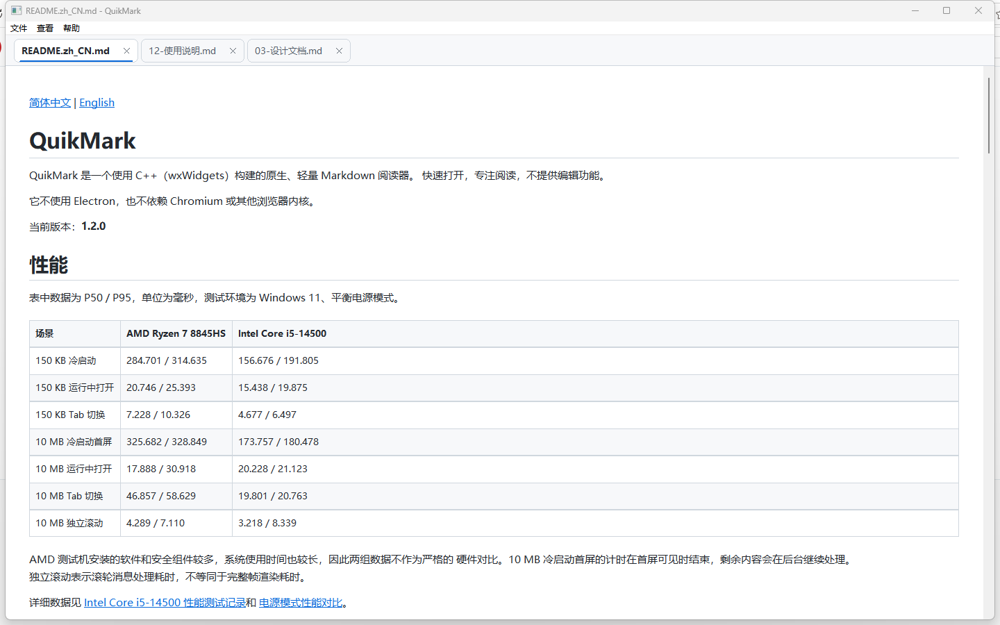
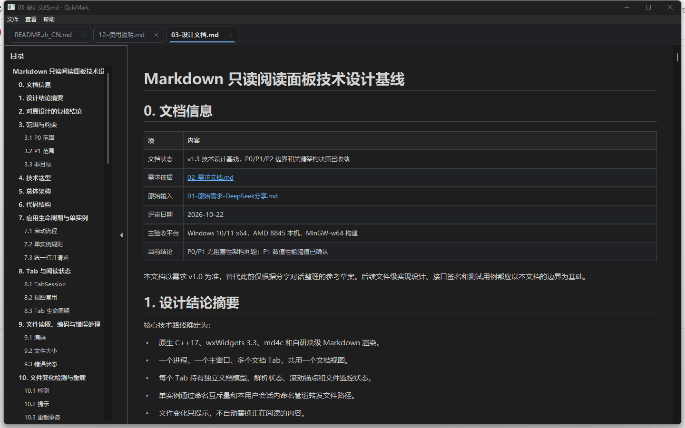

[简体中文](README.zh_CN.md) | [English](README.md)

# QuikMark

QuikMark 是一个使用 C++（wxWidgets）构建的原生、轻量 Markdown 阅读器。
快速打开，专注阅读，不提供编辑功能。

它不使用 Electron，也不依赖 Chromium 或其他浏览器内核。

当前版本：**1.2.0**

## 性能

表中数据为 P50 / P95，单位为毫秒，测试环境为 Windows 11、平衡电源模式。

| 场景 | AMD Ryzen 7 8845HS | Intel Core i5-14500 |
| --- | ---: | ---: |
| 150 KB 冷启动 | 284.701 / 314.635 | 156.676 / 191.805 |
| 150 KB 运行中打开 | 20.746 / 25.393 | 15.438 / 19.875 |
| 150 KB Tab 切换 | 7.228 / 10.326 | 4.677 / 6.497 |
| 10 MB 冷启动首屏 | 325.682 / 328.849 | 173.757 / 180.478 |
| 10 MB 运行中打开 | 17.888 / 30.918 | 20.228 / 21.123 |
| 10 MB Tab 切换 | 46.857 / 58.629 | 19.801 / 20.763 |
| 10 MB 独立滚动 | 4.289 / 7.110 | 3.218 / 8.339 |

AMD 测试机安装的软件和安全组件较多，系统使用时间也较长，因此两组数据不作为严格的
硬件对比。10 MB 冷启动首屏的计时在首屏可见时结束，剩余内容会在后台继续处理。
独立滚动表示滚轮消息处理耗时，不等同于完整帧渲染耗时。

详细数据见
[Intel Core i5-14500 性能测试记录](doc/17-Intel-14500性能测试记录.md)和
[电源模式性能对比](doc/10-电源模式性能对比.md)。

## 界面预览

| 浅色 · 无目录 | 深色 · 带目录 |
| --- | --- |
|  |  |

## 下载

项目主页：[Gitee](https://gitee.com/heloqt/quikmark) |
[GitHub](https://github.com/heloqt/quikmark)

发布页面：[Gitee Releases](https://gitee.com/heloqt/quikmark/releases/tag/V1.2.0) |
[GitHub Releases](https://github.com/heloqt/quikmark/releases/tag/V1.2.0)

| 平台 | 安装包 | 大小 | 下载 |
| --- | --- | --- | --- |
| Windows 10/11 x64 | `quikmark-1.2.0-setup.exe` | 4.21 MiB | [Gitee](https://gitee.com/heloqt/quikmark/releases/download/V1.2.0/quikmark-1.2.0-setup.exe) / [GitHub](https://github.com/heloqt/quikmark/releases/download/V1.2.0/quikmark-1.2.0-setup.exe) |
| Windows 10/11 x64 | `quikmark-1.2.0-x64.msi` | 4.41 MiB | [Gitee](https://gitee.com/heloqt/quikmark/releases/download/V1.2.0/quikmark-1.2.0-x64.msi) / [GitHub](https://github.com/heloqt/quikmark/releases/download/V1.2.0/quikmark-1.2.0-x64.msi) |
| Ubuntu 22.04+ x64 | `quikmark_1.2.0_amd64.deb` | 3.96 MiB | [Gitee](https://gitee.com/heloqt/quikmark/releases/download/V1.2.0/quikmark_1.2.0_amd64.deb) / [GitHub](https://github.com/heloqt/quikmark/releases/download/V1.2.0/quikmark_1.2.0_amd64.deb) |
| Linux x86-64 | `QuikMark-1.2.0-x86_64.AppImage` | 36.02 MiB | [Gitee](https://gitee.com/heloqt/quikmark/releases/download/V1.2.0/QuikMark-1.2.0-x86_64.AppImage) / [GitHub](https://github.com/heloqt/quikmark/releases/download/V1.2.0/QuikMark-1.2.0-x86_64.AppImage) |

SHA256 校验文件：[Gitee](https://gitee.com/heloqt/quikmark/releases/download/V1.2.0/SHA256-1.2.0.txt) /
[GitHub](https://github.com/heloqt/quikmark/releases/download/V1.2.0/SHA256-1.2.0.txt)

## 功能

- Windows 和 Linux 原生单窗口多 Tab 阅读器，只读，不提供编辑和保存功能。
- 支持文件菜单打开、拖入、资源管理器文件关联和第二实例路径转发。
- 读取 UTF-8 / UTF-8 BOM 文件，单个文档最大 64 MiB。
- 支持 Markdown 标题、段落、强调、删除线、列表、任务列表、引用、代码块、链接、水平线、表格和图片。
- 内置 36 个常用项目状态 PNG 图标，保留 ✅、❌、⌛、⏸️、⚠️ 等颜色；
  正文、表格、flowchart 和目录共用透明位图缓存，未收录符号回退为普通文本。
- 支持内容感知表格列宽、表头样式和超宽表格内部横向滚动。
- 本地图片、相对路径图片和 HTTP/HTTPS 网络图片异步加载。
- 支持 Mermaid flowchart 常用方向、节点、边、边标签和单层子图；不支持的内容显示源码。
- `http`、`https`、`mailto` 链接使用系统默认应用打开。
- 支持鼠标跨块选择、表格单元格文字选择、纯文本复制、文档内查找、匹配高亮和上下文跳转。
- 表格支持右键“复制整个表格”，同时写入 HTML 表格和 TSV，便于粘贴到 Word、Excel 或纯文本编辑器。
- 常用快捷键：`Ctrl+O` 打开、`Ctrl+R` 重新加载、`Ctrl+F` 查找、`Ctrl+W` 关闭 Tab、`Ctrl+Tab` / `Ctrl+Shift+Tab` 切换 Tab、`Ctrl+A` / `Ctrl+C` 全选和复制、`F1` 使用说明。
- 三态目录（隐藏/展开/收起）、固定宽度和分隔线三角把手，标题内部锚点和最多 5 条最近文档。
- 恢复窗口位置、Tab 顺序、当前 Tab、阅读位置和目录状态。
- 支持跟随系统、浅色和暗色主题。
- 界面和帮助文档支持跟随系统语言、English 和简体中文，并提供独立中文语言包。
- 检测文件变化并显示非模态重载提示，采用单实例运行。
- 从 liteMark 升级时，首次启动会迁移工作区、最近文档和主题设置。
- 大文档先解析安全前缀并显示首屏，完整内容在后台继续解析。
- 超长段落和超大表格自动分段，避免单个块阻塞首屏与滚动。

完整使用方式见中文版 [使用说明](doc/12-使用说明.md) 或英文版
[Usage Guide](doc/12-Usage.md)。

## 安装与卸载

Windows：

- 默认安装到当前用户目录：`%LOCALAPPDATA%\Programs\QuikMark`，无需管理员权限。
- 开始菜单快捷方式始终创建；桌面快捷方式和 Markdown 文件关联可在安装组件页取消。
- 卸载时恢复安装前的 Markdown 文件关联。
- 安装目录包含 `使用说明.md`，开始菜单提供使用说明入口。
- 完成页的“运行 QuikMark”默认不勾选。

Linux：

- `.deb` 面向 Ubuntu 22.04 x86-64 及兼容的新发行版，可用
  `sudo apt install ./quikmark_1.2.0_amd64.deb` 安装。
- `.deb` 安装后程序入口为 `quikmark`，使用说明位于
  `/usr/share/quikmark/使用说明.md`。
- AppImage 使用前需要执行 `chmod +x QuikMark-1.2.0-x86_64.AppImage`；
  系统没有 FUSE 2 时可执行
  `APPIMAGE_EXTRACT_AND_RUN=1 ./QuikMark-1.2.0-x86_64.AppImage`。
- AppImage 不会自动抢占 Markdown 默认打开方式；需要时在
  “文件 > 注册文件关联...”中启用。

## 构建

推荐使用 MSYS2 的 UCRT64 环境，并安装 wxWidgets 3.3、md4c、CMake 和 Ninja。

仓库中的 CMake Presets 使用 `D:\msys64-33` 作为当前开发机的工具链路径。在其他电脑上构建时，请改为本机实际的 MSYS2 UCRT64 路径，例如 `C:\msys64\ucrt64`。整个构建应使用同一套 MSYS2 根目录，不要混用不同安装目录中的头文件、静态库和 DLL。

构建 Debug 版本：

```powershell
.\scripts\build.ps1 -Preset mingw-debug
.\scripts\run.ps1 -Preset mingw-debug
```

构建可独立运行的 Release 静态版本：

```powershell
.\scripts\build.ps1 -Preset mingw-release-static
.\scripts\run.ps1 -Preset mingw-release-static
```

技术栈：C++17、wxWidgets 3.3、md4c、CMake、MinGW-w64。

语言包位于 `assets/locale/`。修改中文 `.po` 文件后，使用 `msgfmt` 重新生成对应 `.mo`；详细说明见 [语言包说明](assets/locale/README.md)。

## 测试

运行单元测试和 UI 回归：

```powershell
powershell -NoProfile -ExecutionPolicy Bypass `
  -File .\scripts\test.ps1 -Preset mingw-release-static -Integration
```

性能基准：

```powershell
powershell -NoProfile -ExecutionPolicy Bypass `
  -File .\scripts\benchmark.ps1 -Samples 20 -LargeSamples 5
```

连续滚动压力：

```powershell
powershell -NoProfile -ExecutionPolicy Bypass `
  -File .\scripts\continuous-scroll-benchmark.ps1 `
  -Events 120 -IntervalMs 0
```

超大单段落和单表格压力：

```powershell
powershell -NoProfile -ExecutionPolicy Bypass `
  -File .\scripts\block-stress-benchmark.ps1 -Samples 5
```

性能测试脚本需要已构建的 Release 静态版，并在交互式 Windows 桌面中运行。

## 打包

```powershell
powershell -NoProfile -ExecutionPolicy Bypass `
  -File .\scripts\package.ps1
```

版本从 `CMakeLists.txt` 的 `project(... VERSION ...)` 自动读取，安装器输出到 `dist\`。安装包超过 10 MB 时打包失败。

生成 Linux `.deb`：

```bash
bash scripts/package-deb.sh \
  --exe build/linux-release/bin/quikmark \
  --wx-lib-dir /opt/wxWidgets-3.3.0/lib
```

生成 Linux AppImage：

```bash
bash scripts/setup-appimage-tools.sh
bash scripts/package-appimage.sh \
  --exe build/linux-release/bin/quikmark \
  --wx-lib-dir /opt/wxWidgets-3.3.0/lib
```

AppImage 会打包 wxWidgets、libcurl、GTK3、GDK-Pixbuf、图标、MIME 声明和使用说明。
当前产物面向 Ubuntu 22.04 x86_64 及兼容的新发行版。

生成无需开发环境的性能测试包：

```powershell
powershell -NoProfile -ExecutionPolicy Bypass `
  -File .\scripts\create-perf-kit.ps1 `
  -OutputDirectory .\dist\QuikMark-perf-kit `
  -Zip
```

## 文档

- [使用说明](doc/12-使用说明.md)
- [测试矩阵](doc/07-单元测试矩阵.md)
- [Intel Core i5-14500 性能测试记录](doc/17-Intel-14500性能测试记录.md)
- [电源模式性能对比](doc/10-电源模式性能对比.md)
- [启动阶段打点与复测](doc/14-启动阶段打点与复测.md)
- [安全软件冷启动影响测试](doc/13-安全软件冷启动影响测试.md)
- [第三方组件声明](THIRD_PARTY_NOTICES.md)

## 许可证

本项目采用 [GNU Lesser General Public License v3.0](LICENSE) 发布；第三方组件适用各自的许可条款。
